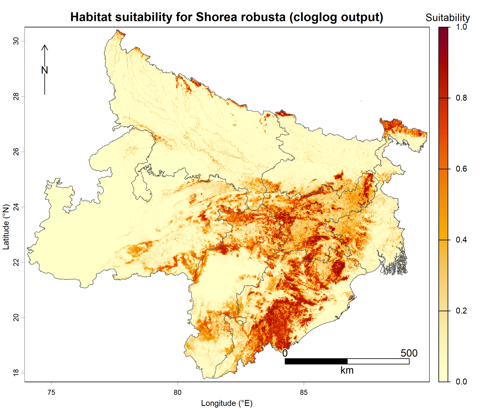
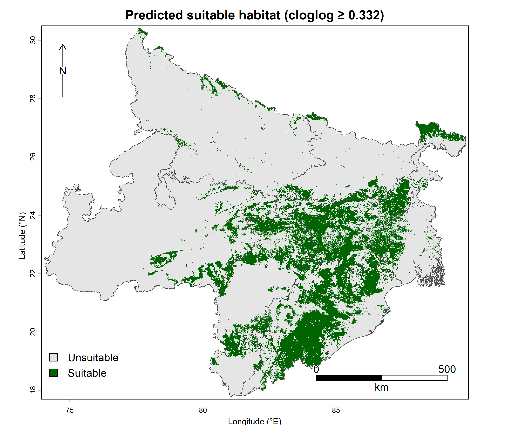

# Shorea robusta | Species Distribution Modelling

**A MaxEnt-based assessment of the relative habitat suitability of Sal (*Shorea robusta*) across seven states of central and eastern India.**

[Portfolio website](https://waliabidi2315.github.io/Maxent-Species-Distribution-Modeling/) · [Full PDF report](reports/Wali_Abidi_M2024BSASS032_Shorea_Robusta.pdf) · [R workflow](analysis/shorea_robusta_workflow.R) · [Source dataset](data/Shorea_Robusta.csv)

---

## Project overview

Sal (*Shorea robusta*) is an ecologically and economically important forest tree across South Asia. This project uses presence-only occurrence records and environmental predictors to model relative habitat suitability across **Uttar Pradesh, Bihar, Jharkhand, Odisha, Chhattisgarh, West Bengal and Madhya Pradesh**.

The analysis combines 19 WorldClim bioclimatic variables with SRTM elevation, derived slope and a 2023 Sentinel-2 NDVI composite. MaxEnt 3.4.4 was used to estimate environmental associations, evaluate model performance and produce continuous and thresholded suitability maps.

## Results at a glance

| Project measure | Reported result |
|---|---:|
| Raw occurrence records | **3,204** |
| Records after exact-coordinate deduplication | **2,739** |
| Records within the seven-state study area | **2,611** |
| Thinned modelling records | **2,392** |
| Environmental predictor layers | **22** |
| Training / test presences | **1,794 / 598** |
| Training AUC | **0.858** |
| Test AUC (SD) | **0.851 (0.006)** |
| Binary-map threshold | **0.332** |
| Area classified as suitable at that threshold | **219,206 km²** (about 29% of the study area) |

The AUC values and area estimate are reported in the accompanying project report. They are model evaluation and threshold-dependent mapping results, not evidence of confirmed occupancy or a field inventory of Sal forest.

## Spatial outputs

### Continuous habitat suitability

The continuous cloglog map shows the spatial pattern of relative suitability predicted by the model.

  

### Binary suitability

The binary map applies the 10-percentile training-presence threshold (cloglog **0.332**) to distinguish cells classified as suitable from those below the threshold.

  

## Key findings

### Geographic pattern

The report identifies the main high-suitability areas in the uplands of Odisha, the Chota Nagpur plateau across Jharkhand and neighbouring West Bengal, higher parts of Chhattisgarh, and patches of eastern Madhya Pradesh. Suitability is generally lower across the Gangetic plain and western Madhya Pradesh.

At the selected threshold, the state-level estimates are:

| State | Suitable area (km²) | Share of state classed as suitable | Share of all suitable area |
|---|---:|---:|---:|
| Odisha | 74,754 | 48.0% | 34.1% |
| Jharkhand | 49,452 | 61.8% | 22.6% |
| Chhattisgarh | 37,581 | 27.8% | 17.1% |
| Madhya Pradesh | 20,896 | 6.8% | 9.5% |
| West Bengal | 19,980 | 23.4% | 9.1% |
| Uttar Pradesh | 8,722 | 3.6% | 4.0% |
| Bihar | 7,821 | 8.3% | 3.6% |
| **Total** | **219,206** | — | **100.0%** |

### Environmental variables

The four largest percent contributions reported by MaxEnt were:

| Predictor | Percent contribution |
|---|---:|
| Slope | **39.0%** |
| NDVI | **20.2%** |
| BIO2 — mean daily temperature range | **12.3%** |
| BIO17 — precipitation of the driest quarter | **10.1%** |

Together, these account for approximately 82% of the reported percent contribution. Permutation importance also places slope, NDVI and BIO2 among the leading predictors, but gives a different ranking to several climate variables.

The report cautions against treating individual climate-variable contribution percentages as definitive: 19 predictor pairs had an absolute correlation above 0.7, and all 19 bioclimatic variables were retained. Correlated predictors can share information and make individual importance scores difficult to interpret.

## Modelling workflow

1. **Occurrence preparation** — remove exact duplicate coordinates, restrict records to the seven-state study area, check environmental coverage and thin records to one occurrence per 1 km grid cell.
2. **Environmental data preparation** — assemble 19 WorldClim v2.1 bioclimatic layers, SRTM elevation, derived slope and 2023 Sentinel-2 NDVI.
3. **Raster harmonisation** — use a common WGS84 coordinate reference system, 30-arc-second grid, common extent and study-area mask; resample elevation and NDVI to the WorldClim grid.
4. **MaxEnt modelling** — run MaxEnt 3.4.4 with 1,794 training presences, 598 randomly held-out test presences and approximately 10,000 background points.
5. **Evaluation and interpretation** — inspect AUC, omission, response curves, permutation importance and jackknife diagnostics.
6. **Mapping and summaries** — produce continuous cloglog suitability, a binary map at the 0.332 threshold, and state-level suitable-area estimates.

## Data and predictors

| Data | Source / description |
|---|---|
| Occurrence records | Supplied *Shorea robusta* species dataset |
| Climate | 19 WorldClim v2.1 bioclimatic variables, 30 arc-seconds; climate normals for 1970–2000 |
| Elevation | Shuttle Radar Topography Mission (SRTM) |
| Slope | Derived in degrees from the elevation layer |
| Vegetation | Mean 2023 NDVI composite from Sentinel-2 surface reflectance imagery, processed in Google Earth Engine |
| Study-area boundary | GADM version 4.1 |

The 22 predictor layers were aligned to a 30-arc-second grid with 1,925 columns and 1,539 rows, then clipped to the combined seven-state study area.

## Repository contents

| Path | Contents |
|---|---|
| `analysis/` | R workflow for occurrence processing and spatial analysis |
| `data/` | Supplied occurrence dataset (`Shorea_Robusta.csv`) |
| `reports/` | Full project report in PDF format |
| `figures/` | Occurrence, environmental-layer, correlation and suitability maps |
| `plots/` | MaxEnt output plots, response curves, ROC, omission and jackknife diagnostics |
| `.github/workflows/` | GitHub Pages deployment workflow |
| `index.html` | Project portfolio page |

## Model evaluation and limitations

The report records a training AUC of **0.858** and test AUC of **0.851 (SD 0.006)**. It describes this as good discrimination within the selected study area, while noting that AUC in presence-background modelling is not equivalent to validation against true absences and depends on the background extent.

Important limitations include:

- **Spatial dependence in the test split:** the 25% test records were selected randomly, not through spatially independent validation. Test locations may be close to training locations, so performance on genuinely new areas may be lower.
- **Collinearity:** 19 predictor pairs had absolute correlation above 0.7. Individual climate-variable importance scores should therefore be interpreted cautiously.
- **Slope response:** the model's sharp response at exactly zero slope is likely an artefact associated with a rare value. The report interprets slope mainly as a contrast between flat plains and gently undulating terrain, not as a preference for steep slopes.
- **NDVI interpretation:** NDVI may represent general forest greenness or canopy cover rather than a response unique to Sal.
- **Different predictor periods:** WorldClim represents 1970–2000 climate normals, while NDVI represents 2023 vegetation conditions.
- **Geographic scope:** state boundaries are practical study limits, not ecological boundaries. Sal also occurs outside the seven states.
- **Threshold dependence:** the 219,206 km² estimate depends on the selected 0.332 threshold and should be read alongside the continuous suitability map.

The model estimates relative environmental suitability. It does not confirm current tree presence, forest condition, abundance, habitat connectivity or the effects of local threats.

## Reproducibility

The repository includes the occurrence CSV, R workflow, report and exported figures/MaxEnt plots. A complete rerun still requires the underlying environmental inputs and software setup, including the WorldClim and SRTM rasters, the 2023 NDVI GeoTIFF, GADM study-area boundaries, and a compatible MaxEnt 3.4.4 installation/configuration. Update local paths in the R script before running it. The presence of exported model outputs does not by itself mean the full modelling run can be reproduced from the repository alone.

## Project materials

- [Open the portfolio page](https://waliabidi2315.github.io/Maxent-Species-Distribution-Modeling/)
- [Read the full PDF report](reports/Wali_Abidi_M2024BSASS032_Shorea_Robusta.pdf)
- [View the R workflow](analysis/shorea_robusta_workflow.R)
- [View the occurrence dataset](data/Shorea_Robusta.csv)
- [Browse figures](figures/)
- [Browse MaxEnt plots](plots/)

## References and data attribution

The project report cites WorldClim v2.1 (Fick and Hijmans, 2017), SRTM elevation (Farr et al., 2007), GADM v4.1, Sentinel-2 MSI Level-2A Surface Reflectance Harmonized accessed through Google Earth Engine, and the MaxEnt method and software (Phillips et al., 2006; Phillips et al., 2017). Refer to the full PDF report for the bibliography and detailed methods.

---

**Project author:** Wali Abidi
